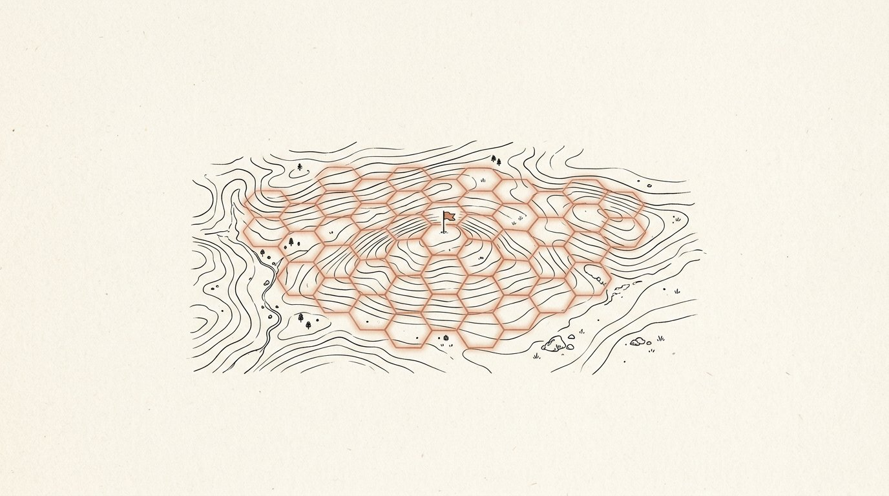
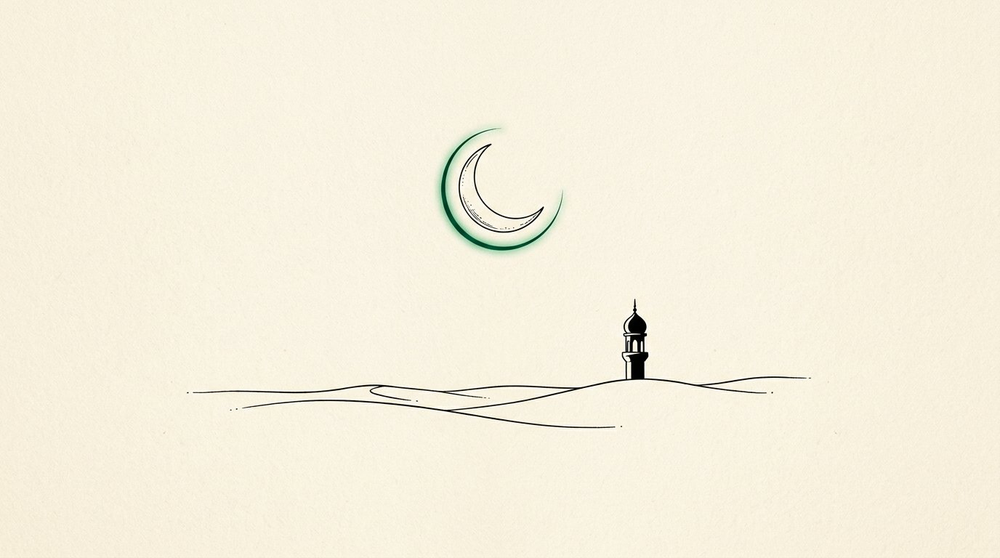
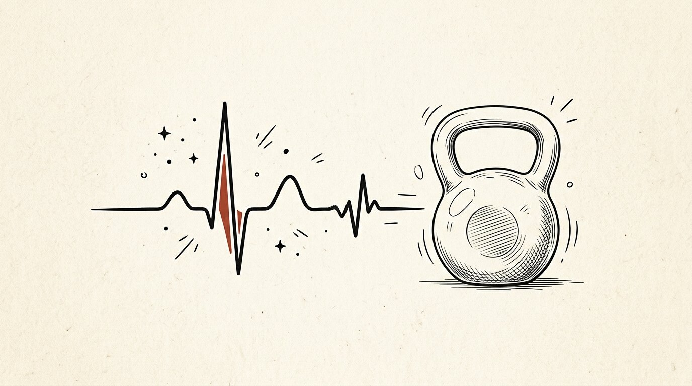
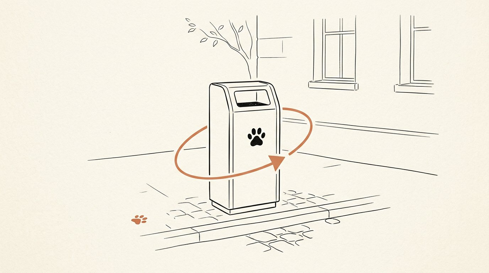

# Nemat Ullah

### Craft&nbsp;over&nbsp;noise.

`Independent developer` · `Abbottabad, Pakistan 🇵🇰` · `34.15°N 73.22°E`

🌐 *Portfolio — “Craft over noise.” (coming soon)*&nbsp;&nbsp;|&nbsp;&nbsp;📧 [khannmat12@gmail.com](mailto:khannmat12@gmail.com)&nbsp;&nbsp;|&nbsp;&nbsp;💬 [WhatsApp](https://wa.me/923160545076)

---

I take products from a rough first sketch to the satisfying last detail — <b>React &amp; Next.js</b> frontends, <b>Node</b> backends, <b>offline-first Android</b> apps, and lately, <b>game feel</b>. Different screens, different constraints — same standard: <i>it should feel obvious once it’s in your hands.</i>

## ▸ Currently — November 2026

- 🏗️ **Building** — TerraStep, my final-year project: a GPS territory-control MMO on a zero-budget stack (verified Postgres claim engine + playable Dart prototype)
- 🚢 **Shipping** — [`yt-extension`](https://github.com/Nemat-commits/yt-extension), a Svelte browser extension for YouTube — PRs and all, in public
- 📚 **Learning** — Game feel, shaders & netcode (Unity / Godot)
- 🤝 **Open to** — Freelance builds, collaborations, and the right full-time remote role

## ✦ Selected work

<table>
<tr>
<td align="center" width="33%">

<b><a href="https://github.com/Nemat-commits/terrastep">TerraStep</a></b> 
GPS territory-control MMO · FYP Dart · PostgreSQL · Multi-agent Python
</td>
<td align="center" width="33%">

<b><a href="https://nematullah9812.github.io/namaz-reminder/">Noor Salah</a></b> · <a href="https://github.com/Nemat-commits/namaz-reminder">src</a> 
Offline prayer times &amp; adhan Android app <b>100% on-device</b> · Emerald/gold · Hijri calendar
</td>
<td align="center" width="33%">

<b><a href="https://nematullah9812.github.io/scientific-calculator-pro/">Scientific Calculator Pro</a></b> · <a href="https://github.com/Nemat-commits/scientific-calculator-pro">src</a> 
Six-mode scientific calculator for Android React 19 · WebView shell
</td>
</tr>
<tr>
<td align="center" width="33%">

<b><a href="https://vortex-labs-one.vercel.app">Vortex Labs</a></b> · <a href="https://github.com/Nemat-commits/Arena-Pc">src</a> 
PC builder &amp; e-commerce experience TypeScript · Next.js
</td>
<td align="center" width="33%">

<b><a href="https://town-fitness-point-psi.vercel.app">Town Fitness Point</a></b> · <a href="https://github.com/Nemat-commits/Town-Fitness-Point">src</a> 
Gym website built for walk-in phones TypeScript · Vercel
</td>
<td align="center" width="33%">

<b><a href="https://pawbin.vercel.app">PawBin</a></b> · <a href="https://github.com/Nemat-commits/PawBin">src</a> 
Smart street pet-waste bins, concept HTML · CSS · JavaScript
</td>
</tr>
</table>

6 of 22 repositories · full list on the <a href="https://github.com/Nemat-commits?tab=repositories">repositories tab →</a>

## ◦ Toolbox

## ◦ By the numbers

<table>
<tr>
<td>

</td>
<td>

</td>
</tr>
</table>
Building in public since April 2025 · 22 public repositories · 12 PRs · 126 commits and counting

## ◦ How I work

> **Obvious beats clever** — if it needs a manual, it failed. 
> **Details are the product** — empty states, offline mode, the 300 ms of latency. 
> **Ship, then sharpen** — a live rough thing beats a perfect invisible one.

---

**Have a product to build, an app to ship, or a game that only exists in your head?**

📧 [khannmat12@gmail.com](mailto:khannmat12@gmail.com) · 💬 [WhatsApp +92 316 0545076](https://wa.me/923160545076) · 🐙 [@Nemat-commits](https://github.com/Nemat-commits)

<i>Craft over noise.</i>

